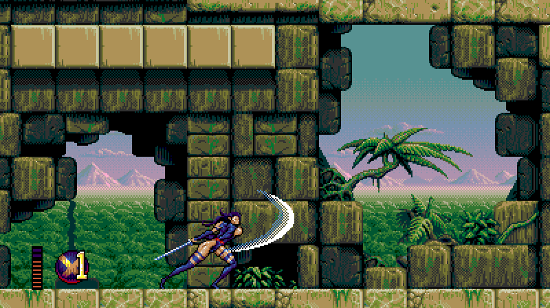
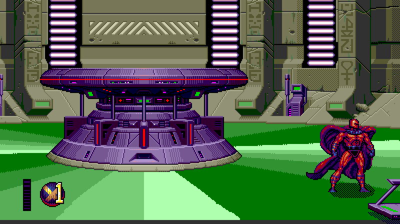

# xmen2-pc

**X-Men 2: Clone Wars** (Sega Genesis, 1995) as a native PC game for Windows and Linux,
built from a complete decompilation, with optional widescreen, high frame rates, two players
at the full 60 fps, and up to four players, on one PC or online.

| | |
|---|---|
|  |  |
|  |  |

*Screenshots from the port at 16:9 (the original is 4:3).*

**You need your own copy of the game.** Nothing of the cartridge is in this repository or
in the downloads. The port reads the graphics, sound and levels from your ROM file every time
it starts, and refuses any file but the USA/Europe cartridge (SHA-1
`61409e6cf6065ab67d8952b891d8edcf47777193`).

## Play

Download the Windows or Linux zip from [Releases](https://github.com/crabsmack/xmen2-pc/releases),
unzip it, and run it with your ROM:

```
XMen2.exe path\to\xmen2.bin          (Linux: ./xmen2 path/to/xmen2.bin; needs SDL2: libsdl2-2.0-0)
```

Keyboard (player 1): arrows; Z = A, X = B, C = C, Enter = Start; A = X, S = Y, D = Z, Q = Mode.
Controllers (players 1-4, in the order they are plugged in): D-pad or left stick; X = A,
A = B, B = C, Start; LB = X, Y = Y, RB = Z, Back = Mode. F11: fullscreen. Esc: quit.

## Options

Every option is off unless you turn it on, so by default the game plays exactly like the
cartridge. Give them on the command line, `XMen2.exe xmen2.bin --options widescreen=16:9,high_fps=144`,
or in `xmen2.ini` next to the program (`[options]`, one per line).

| Option | What it does |
|---|---|
| `widescreen=16:9` | A 16:9 view in the stages; the game plays as in 4:3 (the Cerebro screens stay 4:3). F10 toggles it |
| `widescreen_gameplay=1` | With widescreen: enemies wake and appear across the wide view, and the camera keeps it inside the stage (changes the game) |
| `high_fps=144` | Frames in between the game's own for a 120/144/165/240 Hz display. F9 toggles it |
| `full_rate_2p=1` | Two players at the full 60 frames a second (the original halves it) |
| `players=4` | Three or four players, on one PC (a controller each, in plug-in order) or online: players 3 and 4 join at the player select, with their own panels; the camera keeps everyone in view, and their characters' music parts play on a second sound machine |
| `lives=inf` | Lives are never spent (or `lives=N`, 1-99) |
| `magneto=1` | Magneto can be chosen from the start |
| `start_char=wolverine` | The character you start Siberia with (otherwise random) |
| `magneto_flight=1` | Magneto moves left and right while hovering |

`XMen2.exe --options --json` lists them.

## Online

Rollback netplay for two to four players, each on their own machine with their own ROM file.
The host (seat 0) chooses the options that change the game, and every seat plays with them.
The picture options (`high_fps`, the 16:9 view) are each seat's own.

```
host:    XMen2.exe xmen2.bin --netplay lan --seat 0 --seats 2 --bind 0.0.0.0:7000
seat 1:  XMen2.exe xmen2.bin --netplay lan --seat 1 --seats 2 --bind 0.0.0.0:7001 --peer HOST_IP:7000
```

- `lan`: every seat reaches the host's address directly (on a LAN, over a VPN such as
  Tailscale, or through a forwarded UDP port).
- `hub`: the host relays the other seats' traffic (3-4 players, `--options players=4` on the host).
- `ice`: NAT traversal through a public STUN server; the seats swap connection details as
  files in a shared folder (`--ice-signal-dir DIR`).
- `--input-delay D` sets the delay in frames (default 5). `XMen2.exe --netplay --json` lists the flags.

Everyone must run the same build.

## Status

The game logic is the original's. Every function's C was verified against the cartridge's
machine code, and with every option off the port produces the same game state and picture as
the recompiled cartridge at every frame of the test runs. One difference is deliberate: the
port runs one game frame per displayed frame, so it never slows down where the cartridge
lagged.

Three and four players are new and still being finished: the enemies don't yet treat players
3 and 4 the way they treat players 1 and 2. With 16:9, a few stages show glitches at the edges
of the wide view.

## How it was made

The game was taken apart in [xmen2disasm](https://github.com/crabsmack/xmen2disasm), a
byte-matching disassembly that is also the hub of the project:

1. A disassembly that rebuilds the cartridge byte for byte, cross-checked against an
   instrumented emulator.
2. A static recompilation to C on
   [segagenesisrecomp](https://github.com/mstan/segagenesisrecomp), frame-identical to the
   emulator.
3. The original compiler identified: Apple MPW C 3.3. Hand-written C can therefore be proven
   byte-identical to the ROM.
4. Hand-written, readable C for all 3,621 functions, each one verified.
5. The native port: no 68000 emulation left, the game's memory in the PC's own byte order.
6. The enhancements (16:9, high frame rate, two players at full rate).
7. Multiplayer: savestates, rollback netplay, four players.

Almost all of it was written by AI coding agents (Claude Code) in nine days, under measured
definitions of done. See the disassembly's README and docs/ROADMAP.md there.

## Build from source

You need the ROM (`XMEN2_ROM=path\to\xmen2.bin`, or `../xmen2disasm/xmen2.bin`) and
[uv](https://docs.astral.sh/uv/).

```
git clone --recursive https://github.com/crabsmack/xmen2-pc
cd xmen2-pc
uv sync
uv run tools/xmen2check.py native-build        # -> build/Release/XMen2Native.exe
```

Windows: Visual Studio 2022 with the C++ workload. Linux: `build-essential cmake ninja-build
pkg-config libsdl2-dev`. The rest of `tools/` (the recompiler, the trace harness and the phase
checkers) is described in [CLAUDE.md](CLAUDE.md) and [docs/NOTES.md](docs/NOTES.md).

## License

MIT for the original work here ([LICENSE](LICENSE)). The port is built on segagenesisrecomp,
which is PolyForm Noncommercial, so builds of the port may not be used commercially. No
rights in the original game are claimed or granted. Third-party components and their
licenses: [NOTICE.md](NOTICE.md).
