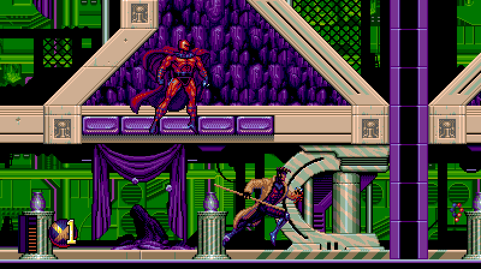
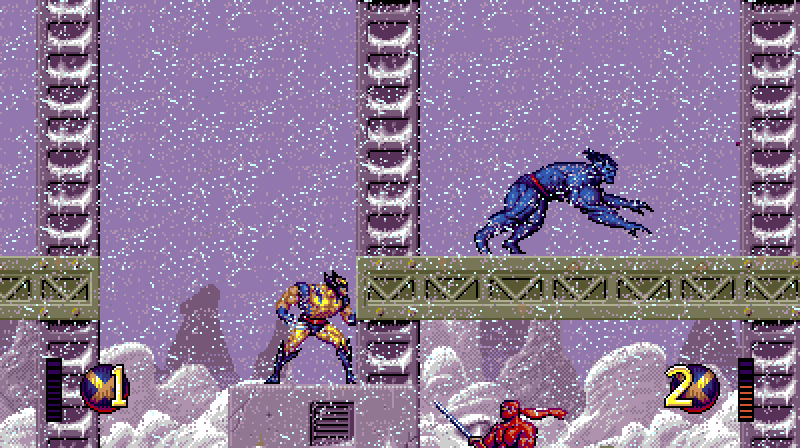
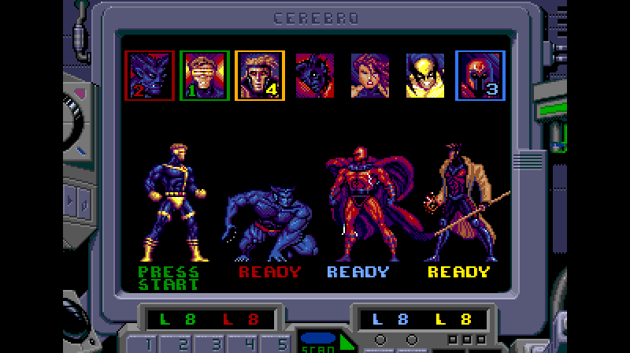
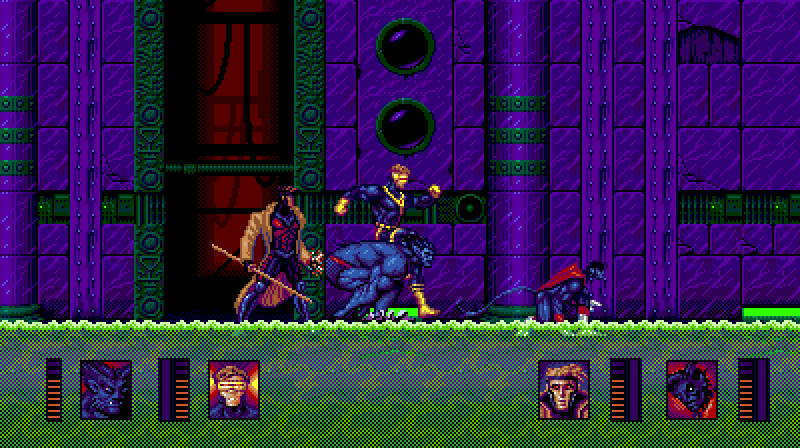

# xmen2-pc

**X-Men 2: Clone Wars** (Sega Genesis, 1995) as a native PC game for Windows and Linux,
built from a complete decompilation, with optional widescreen, high frame rates, two players
at the full 60 fps, and up to four players, on one PC or online.

| | |
|---|---|
|  |  |
|  |  |

*Screenshots from the port at 16:9 (the original is 4:3; its Cerebro screens, like the character
select, stay 4:3), with one, two and four players.*

**You need your own copy of the game.** Nothing of the cartridge is in this repository or
in the downloads. The port reads the graphics, sound and levels from your ROM file every time
it starts, and refuses any file but the USA/Europe cartridge (SHA-1
`61409e6cf6065ab67d8952b891d8edcf47777193`).

## Play

Download the Windows or Linux zip from [Releases](https://github.com/crabsmack/xmen2-pc/releases)
(not the source code), unzip it, and start it: no emulator is needed (or [build it yourself](#build-from-source)).
Started without a ROM (a double-click), it plays the ROM it was last given, or one in its folder;
otherwise it asks for yours with a file picker and remembers it (`[rom]` in `xmen2.ini`). You can
also give it the ROM directly, or drag the ROM onto the program:

```
XMen2.exe path\to\xmen2.bin          Windows
./xmen2 path/to/xmen2.bin            Linux (needs SDL2: libsdl2-2.0-0; the picker needs zenity or kdialog)
```

Keyboard (player 1): arrows; Z/X/C = A/B/C, A/S/D = X/Y/Z, Enter = Start, Q = Mode.
Controllers (players 1-4, in the order they are plugged in; an unplugged controller's player
goes to the next one plugged in): D-pad or left stick;
X/A/B = A/B/C, LB/Y/RB = X/Y/Z, Start = Start, Back = Mode. F11: fullscreen. Esc: quit.

## Options

By default the game plays exactly like the cartridge: every option that changes the game is off
unless you turn it on. What is on by default changes only what you see and hear, never the game:
the picture follows your display (`widescreen` and `high_fps` are `auto`), `music_voices`
plays the music on chips of its own, `sample_retime` and `sample_smooth` play the sound
driver's samples at a steady rate and smoothed, and `fm_chip` is the YM3438.
`widescreen=0,high_fps=0,music_voices=0,sample_retime=0,sample_smooth=0,fm_chip=ym2612` gives
the cartridge's picture and sound. Give options on the command line,
`XMen2.exe xmen2.bin --options widescreen=16:9,high_fps=144`, or in `xmen2.ini` next to the
program (`[options]`, one per line). F9, F10 and F11 say on screen what they did.

| Option | What it does |
|---|---|
| `widescreen=16:9` | A 16:9 view in the stages; the game plays as in 4:3 (the Cerebro screens stay 4:3). F10 toggles it. The default, `auto`, is 16:9 on a display wider than 3:2 (16:10, 16:9, ultrawide), else 4:3 |
| `widescreen_gameplay=1` | With widescreen: enemies wake and appear across the wide view, and the camera keeps it inside the stage (changes the game) |
| `high_fps=144` | Frames in between the game's own for a 120/144/165/240 Hz display (any rate from 61 to 1000). F9 toggles it. The default, `auto`, is the display's own rate when it is over 60 Hz (and follows the window to another display), else off |
| `full_rate_2p=1` | Two players at the full 60 frames a second (the original halves it) |
| `players=4` | Three or four players, on one PC (a controller each, in plug-in order) or online: players 3 and 4 join at the player select, with their own panels; the camera keeps everyone in view, and their characters' music parts play on sound chips of their own |
| `lives=inf` | Lives are never spent (or `lives=N`, 1-99) |
| `magneto=1` | Magneto can be chosen from the start |
| `start_char=wolverine` | The character you start Siberia with: `beast`, `cyclops`, `gambit`, `nightcrawler`, `psylocke`, `wolverine` or `magneto` (otherwise random) |
| `magneto_flight=1` | Magneto moves left and right while hovering |
| `select_idles=1` | On the player select, characters play their idle animations now and then, as when standing in a stage, and Magneto's pick is his standing shot with the flux bomb's explosion sound. Gambit's idle, which the original plays only as his look-up (hold Up), never while standing, plays on the select and when he stands in the stages |
| `music_voices=full` | The default: the music plays on sound chips of its own and the players' music parts on further sets, so neither the parts nor the sound effects take notes from the music, and each player's part plays in full, as one player hears it. On the cartridge, two players' parts need more voices than the chip has, and the effects take voices from the music; with two players or more the game plays each part thinned, one of its tracks muted. `1` keeps the chips of their own with the game's thinned parts, `0` gives the cartridge's single set of chips |
| `sample_retime=1` | The default: the samples the sound driver plays through the YM2612's DAC, in the music and the effects, reach the chip at a steady rate, each up to 4 ms later than the driver writes it (about 2 ms). The driver gets them to the chip unevenly; `0` plays them as it writes them |
| `sample_smooth=1` | The default: between one of those samples' values and the next, the chip gets a straight line, a value at each of its own samples, where the cartridge holds each value until the next (a stair-step, whose steps add high frequencies). `0` holds them. With `sample_retime=0` too, the lines lead to the values at the times the driver writes them |
| `fm_chip=ym3438` | The default: the FM sound (music, effects and samples) on the YM3438, the later version of the Mega Drive's sound chip, which has no DAC "ladder" distortion. The distortion is clearest in quiet passages. `ym2612` gives the YM2612 |

`XMen2.exe --options --json` lists them.

## Online

Rollback netplay for two to four players, each on their own machine with their own ROM file.
The host (seat 0) chooses the options that change the game, and every seat plays with them.
The picture and sound options (`high_fps`, the 16:9 view, `music_voices`, `sample_retime`,
`sample_smooth`, `fm_chip`) are each seat's own,
except that with the host's `widescreen_gameplay=1` the 16:9 view is the host's too (F10 is off).

```
seat 0 (host):  XMen2.exe xmen2.bin --netplay lan --seat 0 --seats 2 --bind 0.0.0.0:7000
seat 1:         XMen2.exe xmen2.bin --netplay lan --seat 1 --seats 2 --bind 0.0.0.0:7001 --peer HOST_IP:7000
```

- `lan`: every seat reaches the host's address directly (on a LAN, over a VPN such as
  Tailscale, or through a forwarded UDP port).
- `hub`: the host relays the other seats' traffic (3-4 players, `--options players=4` on the host).
- `ice`: NAT traversal through a public STUN server; the seats swap connection details as
  files in a shared folder (`--ice-signal-dir DIR`).
- `--input-delay D` sets the delay in frames (default 5). `XMen2.exe --netplay --json` lists the flags.

Everyone needs a v1.1 release: v1.1.0 and v1.1.1 play together, and a v1.0.x seat is refused
when it connects.

## Status

The game logic is the original's. Every function the original wrote in C, 3,047 of 3,164,
has C that compiles with the original compiler (Apple MPW C 3.3) to the cartridge's exact
machine code. The other 117 were written in 68000 assembly, which no compiler produces; their
C is tested against the recompiled cartridge code, with every instruction run and no
differences. With every option
off the port produces the same game state and picture as the recompiled cartridge at every
frame of the test runs. One difference is deliberate: the port runs one game frame per
displayed frame, so it never slows down where the cartridge lagged.

Three and four players are new and have been played less than the rest. Enemies choose their
targets among all the players in play. In two-player stages the original's sound driver
runs short of voices, and the music loses notes to the characters' parts and the sound effects.
By default (`music_voices`) the port gives the music sound chips of its own, so no note is lost,
and plays every player's part in full, where the game thins each part with two players or more.

## How it was made

The game was taken apart in [xmen2disasm](https://github.com/crabsmack/xmen2disasm), a
byte-matching disassembly that is also the hub of the project:

1. A disassembly that rebuilds the cartridge byte for byte, cross-checked against an
   instrumented emulator.
2. A static recompilation to C on
   [segagenesisrecomp](https://github.com/mstan/segagenesisrecomp) (this repo pins a fork,
   [crabsmack/segagenesisrecomp](https://github.com/crabsmack/segagenesisrecomp)),
   frame-identical to the emulator.
3. The original compiler identified and run: Apple MPW C 3.3, under an MPW emulator.
4. Hand-written, readable C for the whole game: 3,164 functions (the disassembly's 3,621,
   less the switch cases and blocks that belong to a parent). The 3,047 the original wrote
   in C byte-match with MPW C 3.3; the 117 written in assembly are tested instruction by
   instruction against the recompiled code.
5. The native port: no 68000 emulation left, the game's memory in the PC's own byte order.
6. The enhancements (16:9, high frame rate, two players at full rate).
7. Multiplayer: savestates, rollback netplay, four players.

Almost all of it was written by AI coding agents (Claude Code) in nine days, under measured
definitions of done. See the disassembly's [README](https://github.com/crabsmack/xmen2disasm)
and [docs/ROADMAP.md](https://github.com/crabsmack/xmen2disasm/blob/main/docs/ROADMAP.md).

## Build from source

You need [uv](https://docs.astral.sh/uv/) and the ROM, named by `XMEN2_ROM`
(Windows: `set XMEN2_ROM=C:\path\to\xmen2.bin`; Linux: `export XMEN2_ROM=/path/to/xmen2.bin`).

```
git clone https://github.com/crabsmack/xmen2-pc
cd xmen2-pc
git submodule update --init --recursive segagenesisrecomp
uv sync
uv run tools/xmen2check.py native-build        # -> build/Release/XMen2Native.exe (Linux: build/XMen2Native)
```

The build doesn't need the `xmen2disasm` submodule (the disassembly; only the recompiler and
the phase checkers use it). The program it builds is the one the zips call `XMen2.exe` / `xmen2`.

Windows: Visual Studio 2022 with the C++ workload. Linux: `build-essential cmake ninja-build
pkg-config libsdl2-dev`. The rest of `tools/` (the recompiler, the trace harness and the phase
checkers) is described in [CLAUDE.md](CLAUDE.md) and [docs/NOTES.md](docs/NOTES.md).

## License

MIT for the original work here ([LICENSE](LICENSE)). The port is built on segagenesisrecomp,
which is PolyForm Noncommercial, so builds of the port may not be used commercially. No
rights in the original game are claimed or granted. Third-party components and their
licenses: [NOTICE.md](NOTICE.md).
